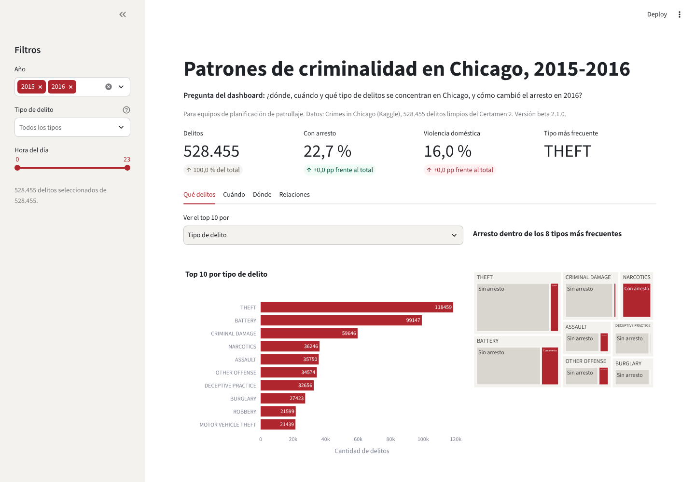

# Criminalidad en Chicago 2015-2016

Dashboard del examen de Taller de Visualización de la Información (UDD, 2026-2). Usa los mismos datos y el mismo análisis del Certamen 2, pero con gráficos interactivos.

La idea es ver dónde, cuándo y qué tipo de delitos se concentran en Chicago, y cómo cambió el arresto en 2016. Está pensado para quienes planifican el patrullaje.

App: https://criminalidad-chicago-tvi.streamlit.app

Versión beta 2.1.0 (Avance I)



## Qué tiene

- Filtros por año, tipo de delito y hora
- 4 KPIs
- Gráficos en cuatro pestañas: qué delitos, cuándo, dónde y relaciones
- Mapa de puntos y mapa de densidad
- Tabla con los datos filtrados

## Datos

Crimes in Chicago, de Kaggle: https://www.kaggle.com/datasets/currie32/crimes-in-chicago

Usamos el archivo limpio del Certamen 2 (años 2015 y 2016, 528.455 delitos), que está en la carpeta data. Pesa 7 MB, así que no hizo falta trabajar con una muestra. Solo el mapa de puntos dibuja 30.000 delitos elegidos al azar (random_state=42) para que cargue rápido. La limpieza está en preparar_datos.py.

## Cómo ejecutarla

```
pip install -r requirements.txt
streamlit run app.py
```

## Integrantes

Diego Sabando, Julio Cerda y Cristóbal Gacitúa
